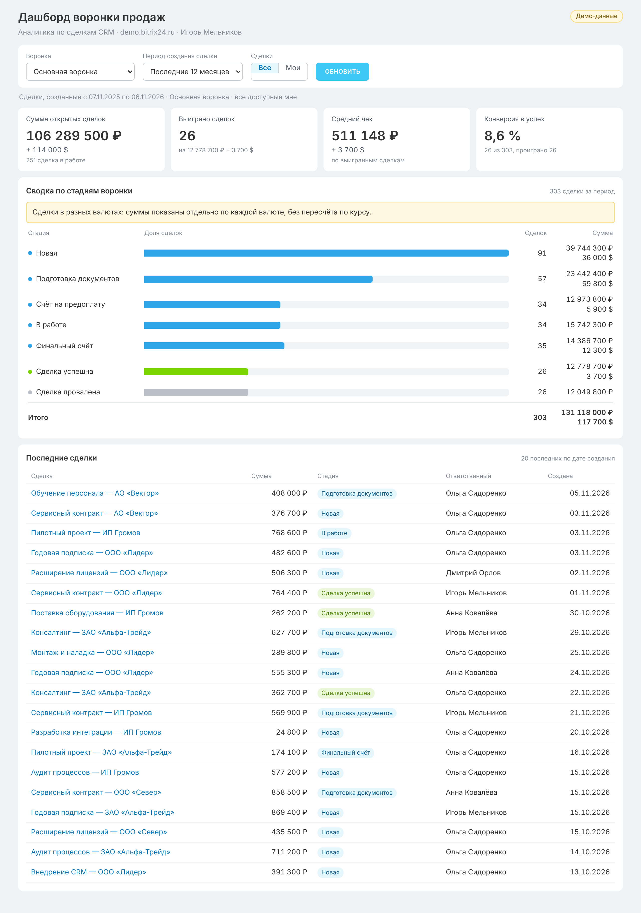

# Дашборд воронки продаж для Битрикс24

Приложение для платформы **Битрикс24 Вайбкод**. Открывается внутри портала Битрикс24 (пунктом левого меню) и показывает аналитику по сделкам CRM **от имени пользователя, который его открыл**. Пользователь видит только те сделки, которые ему разрешено видеть правами CRM.



Краткое описание для проверяющего (0,5–1 страница) лежит в файле [DESCRIPTION.md](DESCRIPTION.md).

## Что умеет

| Блок | Что показывает | Откуда данные |
|------|----------------|---------------|
| **Сводка по стадиям воронки** | Количество сделок и сумма по каждой стадии (`stageId`). Стадии идут в порядке воронки, пустые стадии показаны с нулём, строка «Итого» внизу. При наведении — доля стадии | `GET /v1/statuses` (названия, порядок и семантика стадий) + `POST /v1/deals/aggregate` с `groupBy: ["stageId","currency"]` |
| **Ключевые показатели** | Сумма открытых сделок (стадии «в работе»), число выигранных сделок за период, средний чек (сумма выигранных / их число), конверсия в успех | Тот же агрегат, без выгрузки самих сделок |
| **Последние сделки** | 20 последних сделок: название (по клику открывается карточка сделки в Битрикс24), сумма, стадия, ответственный, дата создания | `GET /v1/deals` (`sort=-createdAt`, `limit=20`) + `GET /v1/users` (имена ответственных) |
| **Фильтры** | Период создания сделки: пресеты (текущий/прошлый месяц, 30 дней, квартал, год, 12 месяцев) или произвольный диапазон. Воронка (направление). «Все / Мои» сделки | Фильтр `createdAt` (`$gte`/`$lte`), `categoryId`, `assignedById` |

Как обрабатывается выбор периода:
- Произвольный период проверяется на клиенте: обе даты обязательны, начало не позже конца, длина не больше 5 лет. Пока ошибка не исправлена, запрос не отправляется, а поля подсвечиваются.
- Сервер повторяет ту же проверку: формат `ГГГГ-ММ-ДД`, существование даты (2026-02-31 отклоняется), порядок дат, белый список значений.
- Обе границы включаются в выборку: с `00:00:00` первого дня до `23:59:59` последнего. Время считается в часовом поясе пользователя Битрикс24.
- Если фильтр сменили, пока загружались прошлые данные, устаревшие ответы отбрасываются.
- Выбранные фильтры запоминаются в браузере (`localStorage`).

## Архитектура

```
Битрикс24 (iframe, левое меню)
   │  placement → обработчик Вайбкод → Gateway (проверяет пользователя)
   ▼
Gateway ── X-Vibe-Authorization: Bearer vibe_session_… ──► server.js (BFF, Node.js)
                                                             │  X-Api-Key: VIBE_APP_KEY (секрет)
                                                             │  Authorization: Bearer <сессия>
                                                             ▼
                                                    https://vibecode.bitrix24.tech/v1/*
```

- `server.js` — HTTP-сервер на встроенном модуле `node:http`. **Внешних npm-зависимостей нет**, поэтому нет и рисков цепочки поставок.
- `src/dashboard.js` — запросы к API и расчёт показателей (чистые функции покрыты тестами).
- `src/vibe.js` — клиент API Вайбкод: таймауты, повтор при `429`/`503` с учётом `Retry-After`.
- `src/params.js` — проверка параметров из браузера.
- `src/demo.js` — демо-режим на сгенерированных данных, без сети и ключей.
- `public/` — интерфейс на HTML, CSS и JS без фреймворков и CDN.

### Безопасность (по памятке «Принципы безопасной VibeCode-разработки»)

- **В репозитории нет ключей и секретов.** Ключ приложения `VIBE_APP_KEY` задаётся секретом в карточке приложения Вайбкод. Код читает его из окружения. `.env` добавлен в `.gitignore`.
- **Токен сессии пользователя не попадает в браузер.** Используется BFF-паттерн: токен приходит от Gateway в заголовке `X-Vibe-Authorization` и пересылается только на сервер платформы. Он не возвращается в JSON-ответах, не сохраняется в `localStorage` и не пишется в логи. Кэш контекста (`/v1/me`) хранится в памяти по SHA-256 от токена, сам токен не хранится.
- **Минимальные права.** Приложение только читает данные: изменяющих запросов к Битрикс24 нет, а сервер отвечает `405` на любые методы, кроме GET и HEAD. Скоупы перечислены ниже, каждый с обоснованием.
- **Данные видны только в пределах прав пользователя.** Запросы идут от его имени, поэтому действуют права доступа CRM Битрикс24. Общего «сервисного» ключа, через который все видели бы данные владельца, нет.
- **Ввод проверяется.** Даты, ID воронки и режим «мои» проверяются по формату и белому списку до того, как попадут в фильтр.
- **XSS исключён.** Названия сделок и имена выводятся через `textContent`, HTML из данных не вставляется. Действует строгий CSP: `script-src 'self'` и `default-src 'self'`, без inline-скриптов и внешних ресурсов. Также выставлены заголовки `nosniff` и `Referrer-Policy: no-referrer`.
- **Статика отдаётся только из белого списка путей**, поэтому обход каталогов невозможен.
- **Ссылка на сделку строится по домену портала из ответа `GET /v1/me`** (доверенный источник), а не из URL страницы. Это закрывает открытый редирект.
- **Наружу не отдаются внутренние подробности ошибок.** На `401` пользователь видит нейтральный текст: заново открыть приложение из меню или выдать доступ.
- **В логах только** метод, путь без параметров, статус, время и `X-Vibe-Request-Id`.

## Скоупы и зачем они нужны

| Скоуп | Зачем |
|-------|-------|
| `crm` | Чтение сделок, их агрегатов, стадий воронки (`/v1/statuses`) и списка воронок (`/v1/deal-categories`). Без него дашборд не работает |
| `user` | Показ имён ответственных в списке последних сделок (`GET /v1/users`). Урезанные скоупы `user_basic` и `user_brief` раздел `/v1/users` не открывают. Без скоупа приложение тоже работает, но вместо имени покажет «Сотрудник #ID» |
| `placement` | Нужен, чтобы опубликовать приложение в портале (`POST /v1/apps/:id/publish`) и при желании добавить вкладку в карточку сделки или пункт меню. Без него публикация возвращает `MISSING_SCOPE` |

Скоупы `vibe:*` приложению не нужны. Для деплоя используется отдельный личный ключ разработчика со скоупом `vibe:infra`, и в приложение он не передаётся.

## Известные ограничения

- **Больше 5000 сделок за период.** API агрегации считает суммы по первым 5000 сделкам (`meta.truncated`). В этом случае дашборд показывает предупреждение. Количество по стадиям при этом точное. Если нужны точные суммы, сузьте период.
- **Валюты не пересчитываются.** Если сделки в разных валютах, суммы показываются отдельно по каждой валюте с пометкой. Курс не применяется.
- **Период фильтрует по дате создания.** «Выигранные за период» — это сделки, созданные в периоде и находящиеся на успешной стадии, а не закрытые в периоде. Так все блоки считаются по одной выборке и согласуются между собой.
- **Одна воронка за раз.** Стадии у разных воронок свои, поэтому общий отчёт по всем воронкам не строится. Воронка выбирается в фильтре.
- **Средний чек** считается по выигранным сделкам (сумма / количество), отдельно по каждой валюте.
- **Сессия.** Сессия Gateway внутри Битрикс24 живёт около 40 минут и продлевается при активности. Если её не продлевать, на `401` нужно заново открыть приложение из меню (это ограничение платформы).
- **Большие порталы.** На портале с тысячами сделок агрегат может строиться несколько секунд, потому что платформа читает сделки страницами. Каждый блок грузится отдельным запросом и показывает свою ошибку с кнопкой «Повторить».
- **`BX24.js` SDK не используется**, потому что при открытии через обработчик Вайбкод он недоступен (по документации платформы). Карточка сделки открывается навигацией верхнего окна.
- **Права на «чужие» сделки.** Режим «Все» показывает все сделки, доступные пользователю по правам CRM. У администратора это все сделки портала.

## Инструкция для проверяющего

1. Откройте портал Битрикс24, в котором установлено приложение, и выберите в левом меню пункт **«Дашборд продаж»**. Можно также открыть его из раздела «Приложения».
2. Сразу после загрузки показан **текущий месяц** основной воронки. Если сделок мало, выберите **«Последние 12 месяцев»**.
3. Проверьте блоки:
   - **сводка по стадиям** — количество и сумма по каждой стадии, строка «Итого» совпадает с суммой строк;
   - **KPI** — сумма открытых сделок, число выигранных, средний чек, конверсия;
   - **последние сделки** — до 20 строк. Клик по названию открывает карточку сделки в Битрикс24.
4. Фильтры:
   - смена воронки;
   - переключатель «Все / Мои» (в режиме «Мои» показаны только сделки, где вы ответственный);
   - **«Произвольный…»**. Если указать дату начала позже даты конца, появится ошибка и запрос не уйдёт. С корректным диапазоном данные обновятся по кнопке «Обновить».
5. Откройте приложение под другим пользователем с ограниченными правами CRM. Данные будут другими, потому что запросы идут от его имени.

**Без портала** интерфейс можно проверить локально на демо-данных:

```bash
DEMO_MODE=1 node server.js
```

После запуска откройте http://localhost:3000. Нужен Node.js 20 или новее, `npm install` не требуется.

## Развёртывание на Битрикс24 Вайбкод

Нужны портал Битрикс24 с доступом к Вайбкод и Node.js 20 или новее на компьютере, с которого делается деплой.

1. **Создайте приложение (ключ авторизации).**
   - Откройте [vibecode.bitrix24.tech](https://vibecode.bitrix24.tech), раздел **«Ключи авторизации»**, и нажмите **«Создать»**.
   - Название — «Дашборд продаж», скоупы — `crm`, `user`, `placement`.
   - Скопируйте ключ `vibe_app_…`: он показывается один раз.
2. **Создайте личный ключ для деплоя.** В разделе **«Ключи API»** создайте ключ `vibe_api_…` со скоупом `vibe:infra`. Он нужен только разработчику для выкладки.
3. **Создайте сервер.** В разделе **Black Hole** создайте сервер или galaxy-приложение и скопируйте его ID (UUID) и адрес вида `https://app-xxxx.vibecode.bitrix24.tech`.
4. **Выложите код** из корня репозитория:
   ```bash
   VIBE_API_KEY=vibe_api_… SERVER_ID=<uuid сервера> node scripts/deploy.js
   ```
   Скрипт упакует `server.js`, `package.json`, `src/` и `public/` и вызовет `POST /v1/infra/servers/:id/deploy` с параметрами `runtime: node24`, `start: node server.js`, `port: 3000` и `healthPath: /health`.
5. **Задайте секрет.** В карточке приложения (раздел «Приложения») в блоке **«Секреты»** заведите `VIBE_APP_KEY` и вставьте ключ `vibe_app_…` из шага 1. Значение применится без повторного деплоя.
   - Если блока «Секреты» на портале нет, передайте ключ при деплое: `VIBE_APP_KEY=vibe_app_… VIBE_API_KEY=… SERVER_ID=… node scripts/deploy.js`. Ключ попадёт в `.env` сервера с правами `0600`.
6. **Укажите адрес приложения.** В карточке приложения в разделе «Ключи авторизации» укажите `appUrl` = адрес сервера из шага 3. То же можно сделать через `PATCH /v1/apps/:id`.
7. **Откройте доступ сотрудникам.** Переведите политику доступа сервера в `PORTAL` (все пользователи портала), либо в `NAMED_USERS` со списком сотрудников:
   ```bash
   curl -X PATCH https://vibecode.bitrix24.tech/v1/infra/servers/<SERVER_ID>/access-policy \
     -H "X-Api-Key: vibe_api_…" -H "Content-Type: application/json" \
     -d '{"accessPolicy":"PORTAL"}'
   ```
8. **Опубликуйте приложение.**
   - Один раз откройте приложение из левого меню портала: так выполняется OAuth-авторизация.
   - Затем опубликуйте его: `POST /v1/apps/<APP_ID>/publish`. Приложение станет видно сотрудникам.
   - Пункт левого меню у приложения появляется сразу после создания. Опционально можно добавить вкладку в карточку сделки: `{"placements": ["CRM_DEAL_DETAIL_TAB"]}`.

Проверка после деплоя:
- `GET <адрес>/health` отвечает `{"ok":true}`;
- при открытии из меню Битрикс24 видны реальные сделки;
- журнал приложения доступен через `GET /v1/infra/servers/<id>/logs?lines=100`.

## Локальная разработка и тесты

```bash
npm test
```

Запускает 17 тестов на `node:test`: расчёт сводки и KPI, валидацию параметров, клиент API и HTTP-слой в демо-режиме.

```bash
npm run demo
```

Запускает интерфейс на демо-данных по адресу http://localhost:3000.
